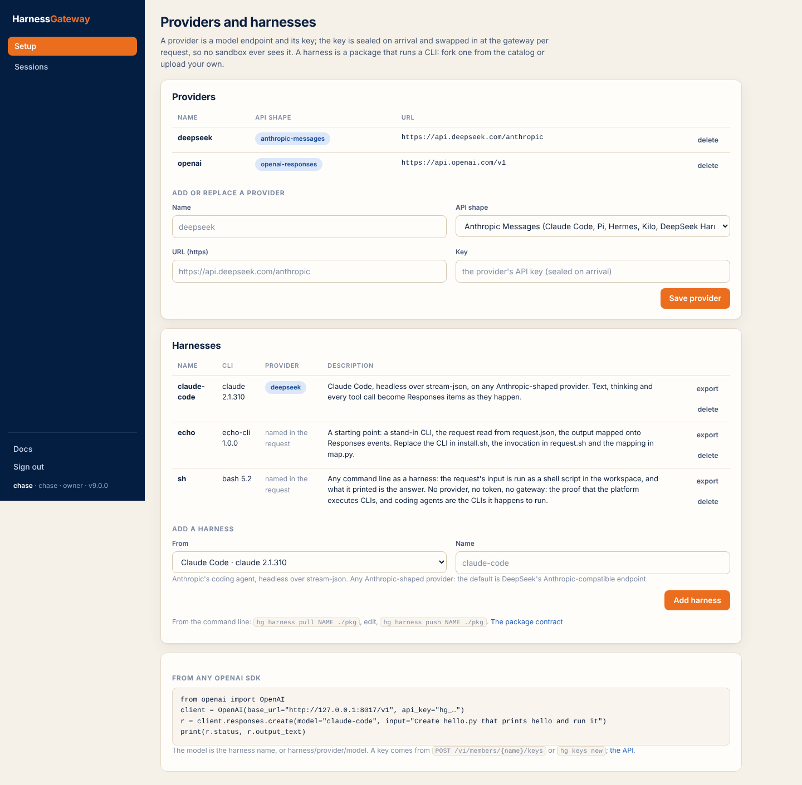
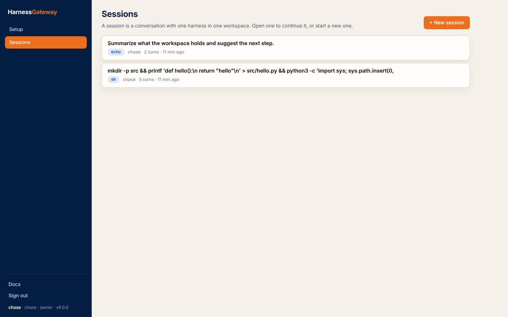
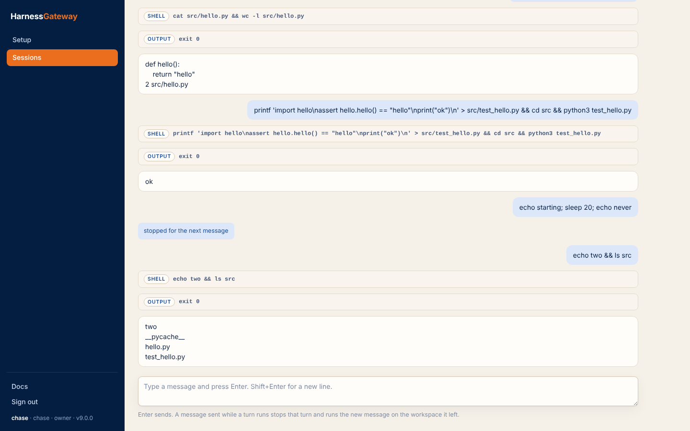
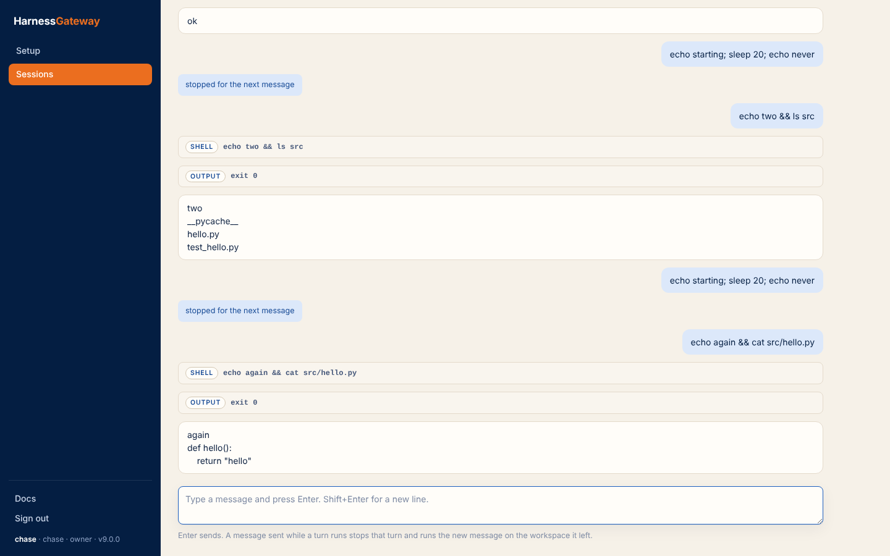

# The app

The app at `/app` is one page over the same routes any client uses; nothing it does is unavailable
to the [API](api.md) or the [command line](cli.md). It is the way a coding agent's web view works:
sign in, Setup (add a provider, add a harness), Sessions (every session, and a new one with the
harness of your choice), type, press Enter.

## Sign in

Email and password, or "Use an API key instead" with a member's key (`hg_…`). With sign-up open,
"Create account" makes an account and an organization of its own; with sign-up closed, an invited
email creates its account and lands in the organization that invited it. An account in several
organizations switches between them at the top of the sidebar.

## Providers and harnesses

Setup, in the sidebar (and where a new organization lands), has two lists. A **provider** is a model endpoint and its key: name, API shape, URL, key; the key is
sealed on arrival and swapped in at the gateway per request, so no sandbox ever sees it
([Providers](providers.md)). A **harness** is a package that runs a CLI: pick one from the catalog
and give it a name, or upload a package archive of your own ([Harnesses](harnesses.md)). Owners add
and remove both; members see them.

<figure class="shot" markdown>

</figure>

## Sessions

Sessions, in the sidebar, lists every session the member can see (an owner sees the
organization's), newest first, with its harness, its turns and whether it is running; open one to
continue it.

<figure class="shot" markdown>

</figure>

"+ New session" opens the composer with a harness to choose (and a provider and model when the
package has no default or you want another). Type and press Enter; Shift+Enter is a new line. The
items stream in as the harness produces them: commands with their output, patches, reasoning,
messages. The session appears in the list with its title (the first line you typed) and reopens
from there, including one still running from another client: the stream resumes from its start.

<figure class="shot" markdown>

</figure>

There is no steer and no stop button. **A message sent while a turn runs stops that turn** and runs
the new message on the workspace the stopped turn left: the running package gets its stop signal
and its grace, the stopped response ends `cancelled` with `metadata.incomplete_reason: superseded`
(the thread says "stopped for the next message"), and the new turn starts when the old one has
ended. Closing the tab mid-turn stops the turn too, since the request that made it is gone.
Over the API it is the same rule: a `POST /v1/responses` with `previous_response_id` naming a
session that is running a turn supersedes it ([Sessions](sessions.md)).

<figure class="shot" markdown>

<figcaption>A message sent mid-turn: the running turn stops, the new message runs on the same workspace.</figcaption>
</figure>
