# The console's Setup pages, part by part

Providers, Environments and Harnesses: what each part of each page shows, the API call behind it, and what
the platform does with that call. The screenshots are from version 4.4.0, run on one machine with the shell
package, Claude Code, Codex and Kilo. Paths are under `harnessgateway/`.

- [One click, end to end](#one-click-end-to-end)
- [Providers](#providers)
- [Environments](#environments)
- [Harnesses](#harnesses)
- [Who may do what](#who-may-do-what)
- [A turn, where the three meet](#a-turn-where-the-three-meet)

## One click, end to end

The console has no server of its own. It is static files (plain JavaScript modules, no build step) served by
the same process that serves the API, on the same port. Every page is a function that fetches from `/v1/…`
with the key you signed in with and writes HTML into the page. The platform does all checking; the pages only
hide buttons that would be refused.

### Loading and signing in

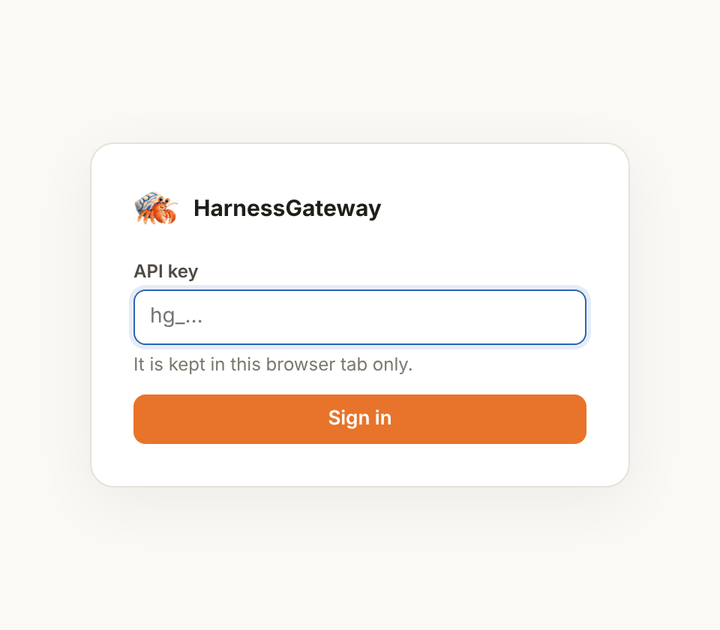

1. The browser asks for `/`. The catch-all route in `api/public.py` returns `console/index.html` with a
   content-security policy: scripts from this origin and one pinned library host, network calls to this
   origin only.
2. `console/app.js` runs `boot()`: `GET /v1/platform` with no key. The answer is 401, so the sign-in form
   shows.
3. You paste a key. The form calls `GET /v1/platform` with `Authorization: Bearer hg_…`. On 200 the key is
   kept in `sessionStorage` (this browser tab only) and the answer (`role`, `version`, `driver`, `isolation`)
   decides what the sidebar lists.
4. The sidebar comes from `nav(me)` in `console/pages.js`. Setup is shown to every role; Access only to an
   admin.

### The router and a page

The address after `#/` picks the page: `#/environments/research` is page `environments` with parameter
`research`. On every change `route()` in `console/app.js` replaces the content element with a fresh one and
calls that page's `render(el, params, me)`. Pages keep no state between visits. After any save, the page calls
`rerender()`, which runs the router again, so the page fetches everything again from the API.

### What happens to a request on the server

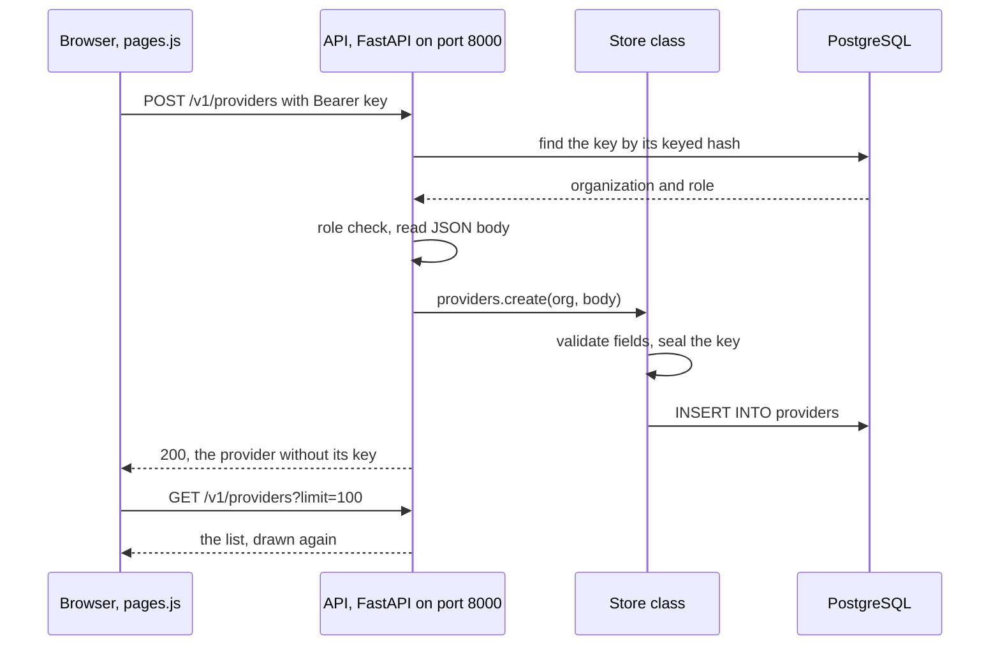

| Step | What it does | Where |
|---|---|---|
| Fetch | Adds the Bearer key, sends JSON, turns a refusal into an error whose text is the API's own message. A 401 sends you back to sign-in | `call` in `console/api.js`, `api` in `console/lib.js` |
| Who is calling | An extension is asked first (the core has none). Then the key: its HMAC-SHA256 hash is looked up, `last_used_at` is updated, and the result is a principal: organization, key id, role | `Authenticator` in `api/auth.py`, `Keys.authenticate` in `store/keys.py` |
| Role | Each route names the least role it needs. Roles are ordered runner, developer, admin. Too low a role is a 403 | `Authenticator.role` in `api/auth.py`, `domain/principal.py` |
| Body | Read up to 32 MiB, must be JSON, and must hold no NUL character | `read_json` in `api/public.py` |
| Validation | Each definition is a strict model: an unknown field is refused, and the refusal names the field, as in `color: is not a known field` | `Definition` in `domain/definition.py` |
| Storage | One store class per group of tables. Each call is a transaction that carries the organization's id | `Database.org` in `store/db.py` |
| Refusal | Any refusal becomes the OpenAI error shape, `{"error": {"message", "type", "param", "code"}}`, with status 400, 401, 403, 404, 409 or 413. The console shows the message as a red toast | `install` in `api/errors.py`, `fail` in `console/views.js` |
| Told to extensions | After each change, `Platform.audit` tells loaded extensions who changed what. The core stores nothing of it | `platform.py` |

## Providers

A provider is a model endpoint: a name, one or more API shapes each with a base URL, a list of models to
offer, and a key. Page: `providers` in `console/pages.js`. Routes: `providers_router` in `api/management.py`.
Store: `store/providers.py`. Rules: `domain/provider.py`.

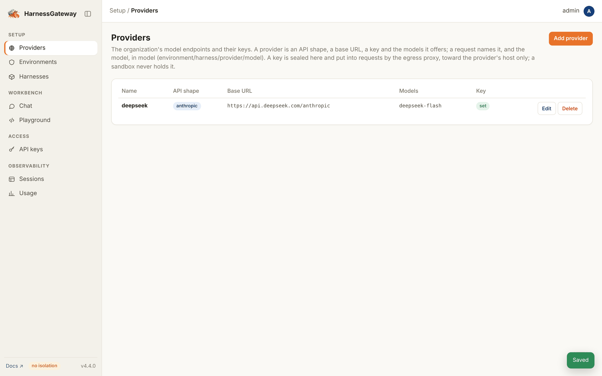

The page makes one call to draw this: `GET /v1/providers?limit=100`.

| Part | What it shows or does | Behind it |
|---|---|---|
| Name | The provider's name, the third part of a model string | Lower-case letters, digits and hyphens, up to 63 characters. `none` is refused, because in a model string it means no provider |
| API shape | One pill per API the endpoint speaks | Keys of `apis`. Four are allowed: `anthropic`, `openai-responses`, `openai-chat`, `gemini` |
| Base URL | Where requests for that API go | Must be http or https with a host, no credentials, query or fragment. A trailing slash is removed |
| Models | What the chat and playground pickers offer | Up to 100, no duplicates. A request may still name any model the endpoint serves; this list is not a filter |
| Key | *set* or *no key* | `has_key`, computed in SQL as `key_sealed IS NOT NULL`. No route ever returns the key |
| Edit, Delete, Add provider | Shown to an admin only | `PATCH`, `DELETE` and `POST` all need the admin role on the server too |

### The dialog, field by field

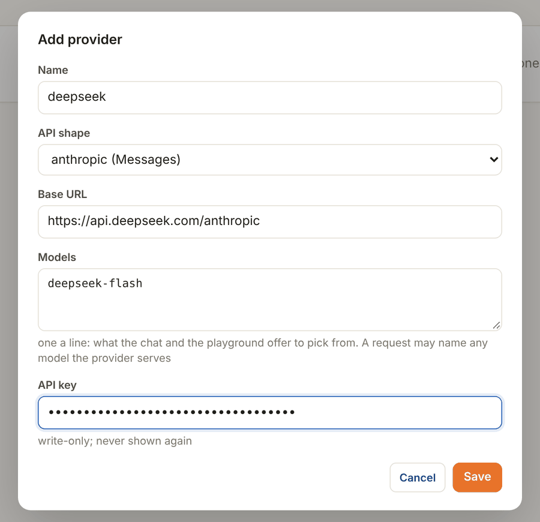

Edit opens the same dialog with the name locked.

- **Name**: locked when editing. The store allows changes to `apis`, `models` and `api_key` only.
- **API shape**: choosing a shape fills in that vendor's base URL, unless you already typed your own. The
  dialog sets one shape. A provider that speaks several is set through the API; the dialog warns before it
  saves such a provider, because saving leaves it with the one shape shown.
- **Base URL** and **Models** (one a line, or comma-separated).
- **API key**: a password field. Left empty on edit, the field is not sent and the stored key stays. Removing
  a key without replacing it is `PATCH` with `"api_key": null`, through the API.

Save sends exactly this:

```
POST /v1/providers
{"name": "deepseek",
 "apis": {"anthropic": "https://api.deepseek.com/anthropic"},
 "models": ["deepseek-flash"],
 "api_key": "<the key typed>"}
```

### What the platform does with it

1. `Providers.create` in `store/providers.py` takes `api_key` out of the body and validates the rest as a
   `Provider`.
2. The key is sealed with AES-256-GCM under `HG_SECRET_KEY`. The seal is bound to the organization, the word
   `provider` and the provider's name, so sealed bytes copied onto another row do not open
   (`domain/sealing.py`).
3. One row goes into `providers`: `apis` and `models` as JSON, `key_sealed` as bytes. A second provider of
   the same name is a 409.
4. The response is the provider plus `has_key` and `created_at`.

Delete removes the row. From then on a request naming that provider is refused when its model string is
resolved.

### Where a provider is used later

A request's model string is resolved by `resolve` in `domain/resolve.py`. The provider must speak one of the
harness's APIs; the first API in the harness's own order that the provider has is the one used. The key
itself never goes into a sandbox. The sandbox gets a placeholder, and the egress proxy puts the real key in
on the way out. [A turn](#a-turn-where-the-three-meet) shows this.

## Environments

An environment is where turns run: an image, an optional setup script, the harnesses it carries, limits, a
network policy, variables and secrets. It is the first part of a model string. Pages: `environments` (the
list), `environment` (one environment) and `environmentDialog` in `console/pages.js`. Routes:
`environments_router` in `api/management.py`. Store: `store/environments.py`. Rules: `domain/environment.py`.

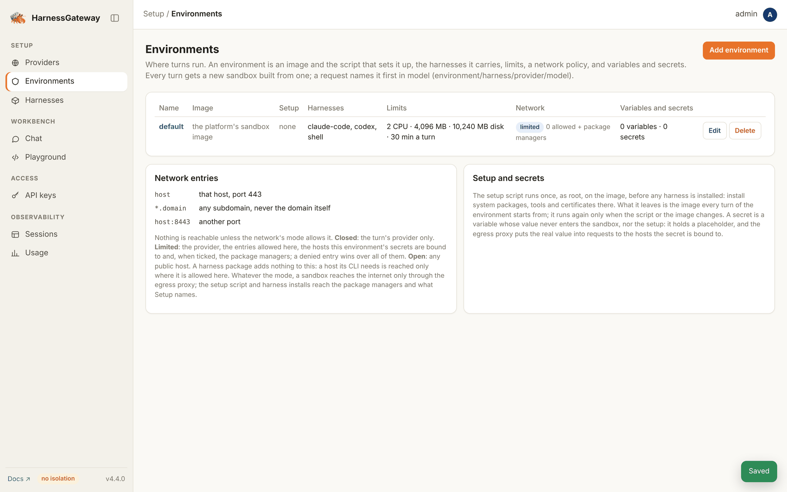

The list makes two calls: `GET /v1/environments?limit=100` for the rows and `GET /v1/harnesses?limit=100` for
the dialog's checklist. The two cards under the table are fixed help text.

| Column | What it shows | Behind it |
|---|---|---|
| Name | Link to the environment's own page | `name`. It cannot be changed after creation |
| Image | The image named, or "the platform's sandbox image" | `image`. Null means the sandbox image of whatever version is running |
| Setup | *none*, *waiting*, *setting up*, *set up* or *setup failed* | `build.status` of the build the environment was last prepared with |
| Harnesses | Each carried harness, with a pill when its install is not ready | `installs[]`: one entry per carried harness with its install's status on the environment's image |
| Limits | CPU, memory, disk and time per turn | `cpus`, `memory_mb`, `disk_mb`, `turn_timeout_s` |
| Network | Mode pill and counts of allowed and denied entries | `network.mode`, `allow`, `deny`, `package_managers` |
| Variables and secrets | Counts only | Secret values are never returned: a secret shows as its hosts, header and prefix |

### The dialog, group by group

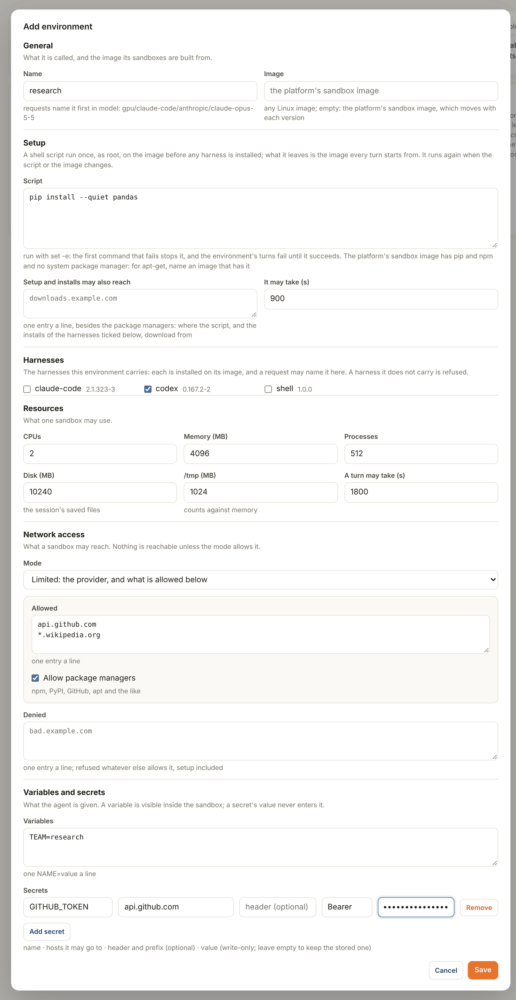

The dialog as filled for an environment named `research`.

- **General**. Name (locked on edit) and image. An empty image is sent as `null`.
- **Setup**. A shell script, up to 64 KiB, run once as root on the image with `set -e`. "Setup and installs
  may also reach" is `setup.egress`: extra hosts for the script and for harness installs. Time limit 1 to
  3600 seconds.
- **Harnesses**. One checkbox per harness the organization has. The server refuses a name it does not know.
- **Resources**. CPUs 0.25 to 64; memory from 256 MB; processes from 64; disk for the session's saved files;
  `/tmp`, which counts against memory and may not exceed it; seconds a turn may take.
- **Network access**. Closed: the turn's provider only. Limited: the provider, the Allowed entries, the hosts
  of this environment's secrets and, when ticked, the package managers. Open: any public host. Denied entries
  win over everything. The form hides Allowed outside Limited and Denied in Closed, and the server refuses
  those combinations too.
- **Variables and secrets**. Variables are `NAME=value` lines, visible in the sandbox; names the platform
  sets itself (`HOME`, `HG_…`, proxy and certificate variables) are refused. A secret has a name, the hosts
  it may go to, an optional header and prefix, and a value. On edit, an empty value keeps the stored one.

Save always sends the whole definition, on create and on edit:

```
POST /v1/environments
{"name": "research", "image": null,
 "setup": {"script": "pip install --quiet pandas", "egress": [], "timeout_s": 900},
 "harnesses": ["codex"],
 "cpus": 2, "memory_mb": 4096, "pids": 512,
 "tmp_mb": 1024, "disk_mb": 10240, "turn_timeout_s": 1800,
 "network": {"mode": "limited", "allow": ["api.github.com", "*.wikipedia.org"],
             "package_managers": true, "deny": []},
 "variables": {"TEAM": "research"},
 "secrets": {"GITHUB_TOKEN": {"hosts": ["api.github.com"], "prefix": "Bearer ", "value": "<the value typed>"}}}
```

### What Save starts on the server

The route writes the row and answers at once. Preparing the environment runs afterwards in the background,
inside the same server process (`Platform.prepare_in_background` in `platform.py`, `Preparer.prepare` in
`runner/prepare.py`).

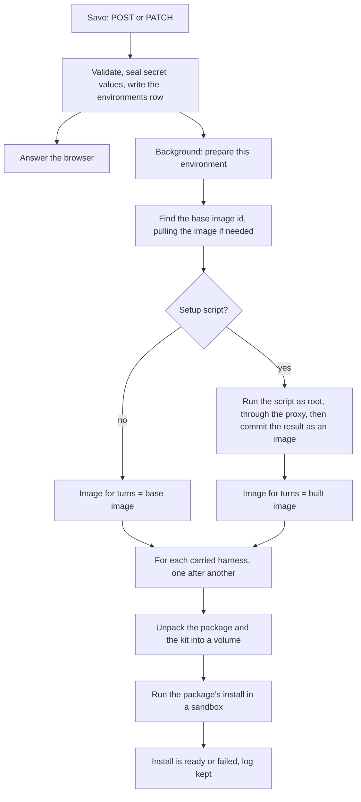

| Stage | Detail | Where |
|---|---|---|
| Row | Secret values are split from the definition. The definition goes into `spec` as JSON; each value is sealed, bound to this environment's name, into `secrets_sealed` | `Environments.create` in `store/environments.py` |
| Edit | `PATCH` replaces the top-level fields sent and keeps the rest. A secret left out of `secrets` is removed. A secret sent without a value keeps its sealed value | `Environments.update` in `store/environments.py` |
| Build | One build per organization, base image id and script hash, so the same script on the same image is built once. It runs under `docker run … /bin/sh -s` with the script on standard input, then `docker commit` | `Builder.ensure` in `runner/builder.py`, `build` in `drivers/docker.py` |
| What setup may reach | The package managers, `setup.egress` and the hosts of the environment's secrets. Denied entries stay denied | `domain/plan.py` |
| Install | One install per package digest and image id. A trusted step fetches the package archive from the internal API with a one-time token and lays it out with the kit. Then the package's own `install` runs as user 10000, read-only root, no capabilities | `Installer.ensure` in `runner/installer.py` |
| What an install may reach | The package managers and `setup.egress`, nothing else. A package cannot add a host | `install_policy` in `domain/plan.py` |
| Other triggers | Every environment is prepared when the server starts. Adding or replacing a harness prepares the environments that carry it. A turn that arrives first runs the same build and install itself and waits for them | `serve.py`, `runner/turn.py` |
| Delete | Removes the row. Its built image and installs are removed later by housekeeping, after an hour unused | `Platform.remove_unused_builds` in `platform.py` |

### One environment

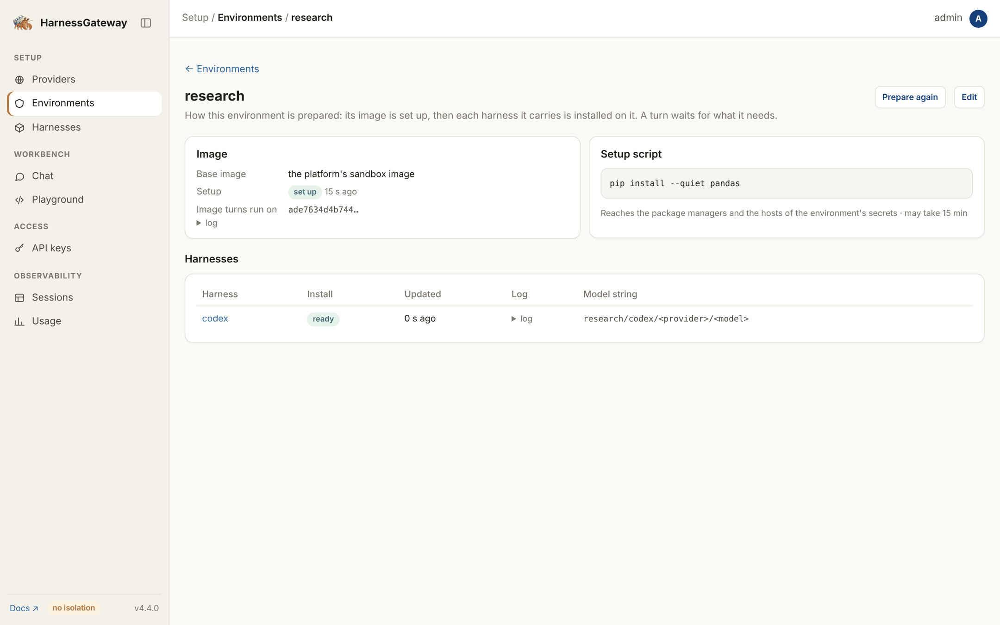

The `research` environment about 45 seconds after Save. Calls: `GET /v1/environments/research` and
`GET /v1/harnesses?limit=100`.

| Part | What it shows or does | Behind it |
|---|---|---|
| Base image | The image named, or the platform's | `image` |
| Setup | The build's state and when it last changed, with its log under "log" | `build.status`, `build.updated_at`, `build.log` (the last 64 KiB; the page shows the last 8,000 characters) |
| Image turns run on | Short id of the image sandboxes start from | `image_id`. Empty until prepared, and while a build has failed |
| Setup script card | The script, what it may reach, its time limit | `setup` |
| Harnesses table | Per harness: install state, when, log, and the model string to use | `installs[]`. If the proxy refused hosts during an install, they are listed with the advice to add them under Setup |
| Prepare again | Tries again what failed | `PATCH` with an empty body. Any `PATCH` starts preparation |
| Refresh | While a build or install is pending the page redraws itself every 3 seconds | `environment` in `console/pages.js` |

In this run the build took about 30 seconds and produced a new image. Codex was then installed a second time,
for that image: the installation held two Codex installs, one for the default environment's image and one for
this one. Logs are returned to a developer or an admin; a runner key gets the same page data without them.

## Harnesses

A harness is an added package: a folder with `harness.json`, an `install` script and a `run` script. Adding a
harness makes it available to the organization. It runs nowhere until an environment carries it. Pages:
`harnesses` (the list), `harness` (one harness) and `drafts` (the editor) in `console/pages.js`. Routes:
`harnesses_router` in `api/management.py`, and `api/drafts.py`. Store: `store/harnesses.py`.

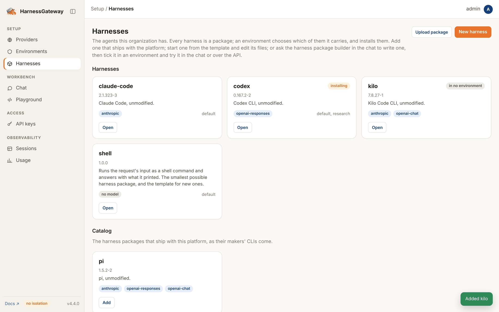

Just after adding `kilo` from the catalog. Calls: `GET /v1/harnesses?limit=100`, `GET /v1/drafts`,
`GET /v1/catalog`.

| Part | What it shows or does | Behind it |
|---|---|---|
| Drafts | Packages being written in the console. Shown only when there are any | Rows in `drafts` and `draft_files` |
| Harness card | Name, version, description, the APIs it speaks (or "no model"), and the environments that carry it | The package's manifest, plus `environments[]` worked out per harness |
| State pill | Nothing when installed everywhere it is carried. Otherwise *in no environment*, *installing* or *install failed*. Codex shows *installing* above because its install for `research` was still running | `installState` in `console/pages.js` |
| needs settings | A required setting or secret has no value. Requests naming the harness are refused until it has | `missing[]`, from `Harness.missing` in `domain/harness.py` |
| Catalog | Packages in the platform's catalog folder that are not added, or are added at another version. The button reads Add or "Update to …". A new installation adds every catalog package, so the section is empty until an update brings new or newer ones | `GET /v1/catalog` reads the folder named by `HG_CATALOG` on each call |
| Add | Adds a catalog package | `POST /v1/harnesses {"catalog": "kilo"}` |
| Upload package | Adds a `.tgz` you built | `POST /v1/harnesses`, multipart, field `package` |
| New harness | Starts a draft from the shell template under the name you give | `POST /v1/drafts {"name": "my-agent"}` |

### What adding a harness does on the server

1. The archive is validated whole before anything is stored: gzip tar, plain files only, at most 64 MiB
   packed and 5,000 files, a valid `harness.json`, and `install` and `run` present and executable
   (`read_archive` in `domain/archive.py`).
2. Its digest is a SHA-256 over each file's path, executable bit and content. The archive is kept in the blob
   store under that digest.
3. The `harnesses` row is inserted, or pointed at the new digest if the name exists. A replaced harness keeps
   each setting and secret the new manifest still declares (`Harnesses.add` in `store/harnesses.py`).
4. The environments that already carry the harness are prepared again, which installs the new version. A new
   harness is carried by none, so nothing is installed yet.

### One harness

The page loads `GET /v1/harnesses/{name}` and, for a developer or admin, `GET /v1/harnesses/{name}/files`.
**Edit** copies the added files into a draft of the same name (`POST /v1/drafts {"name", "harness"}`) and
opens the editor. **Remove** deletes the harness and takes its name off every environment that carries it.

**Files.** The package exactly as added. Clicking a file calls `GET …/files/{path}`; text is shown, anything
else as "(binary, size)".

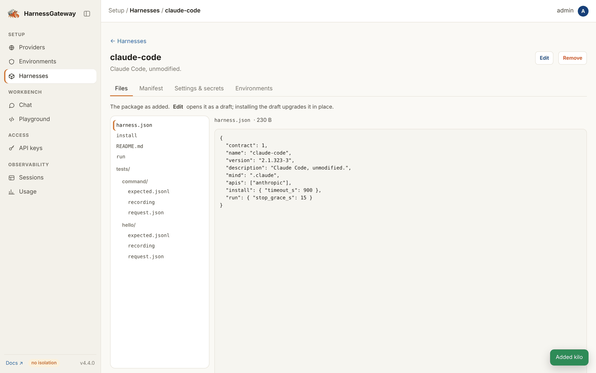

**Manifest.** Version, digest, provider APIs, the folder under `$HOME` the CLI keeps its own state in, the
install time limit, and the raw `harness.json`.

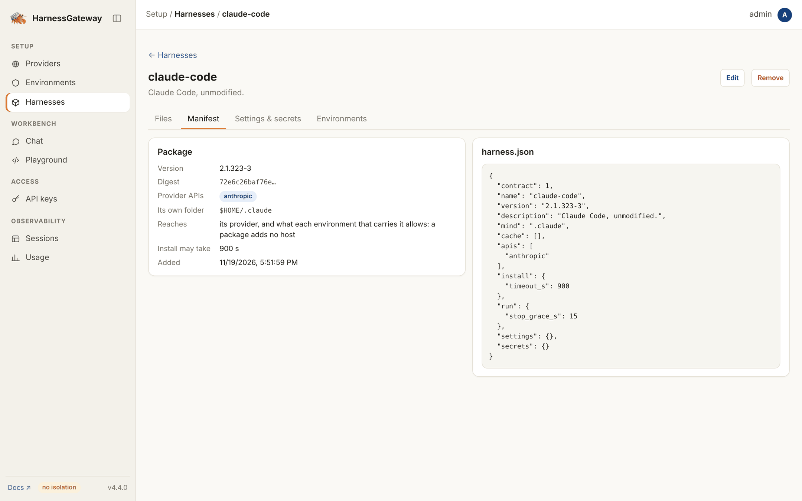

**Settings & secrets.** One field per setting the package declares, filled with its value in effect. Save
sends `PATCH {"settings": {…}}` with every field; an emptied field is sent as `null`, which unsets it.

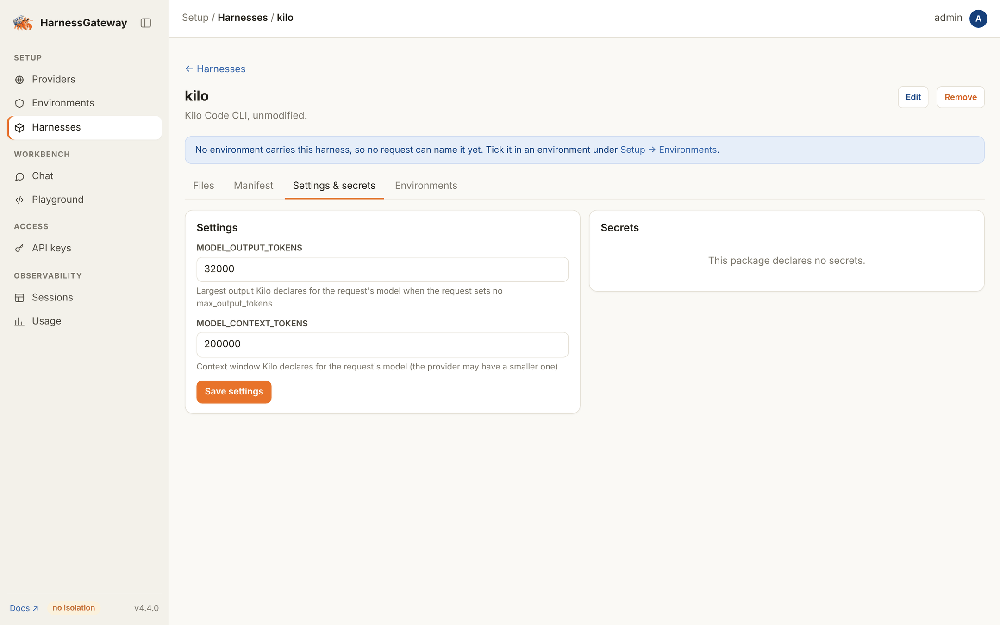

**Environments.** Where the harness is carried, its install state there, and the model string to send.

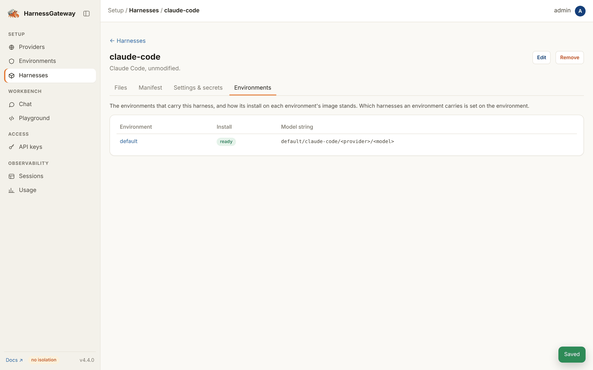

### Settings and secrets, precisely

- A **setting** is a plain value a developer may set. In a turn it becomes an environment variable in the
  sandbox (`sandbox_plan` in `domain/plan.py`).
- A **secret** is set by an admin only. The route checks this itself when the body holds `secrets` (`update`
  in `harnesses_router`). The value is sealed, bound to the harness's name. In a turn the sandbox holds a
  placeholder, and the proxy puts the value into requests to the hosts the package declared, where the
  environment allows that host.
- Only names the manifest declares are accepted, for both.

### The draft editor

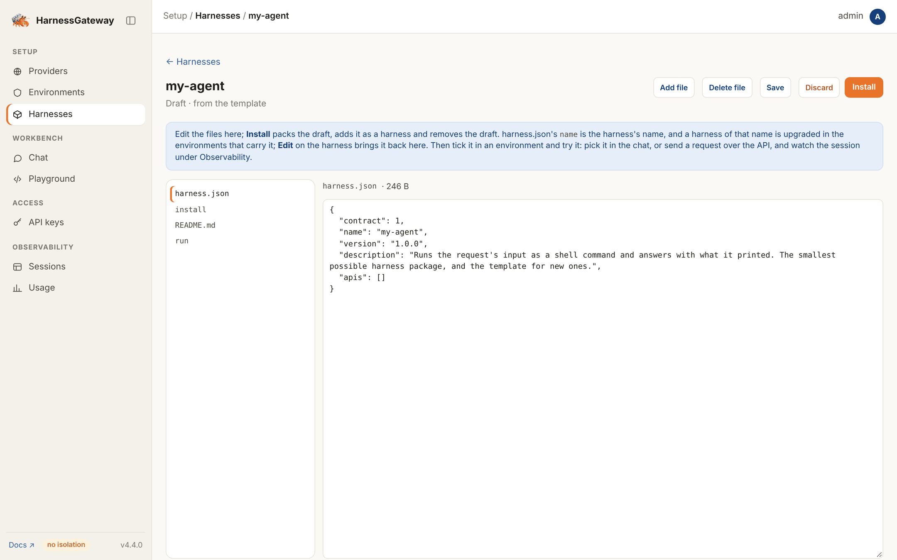

The editor after New harness. Each Save is `PUT /v1/drafts/{name}/files/{path}` with the file's bytes. Install
is `POST /v1/drafts/{name}/install`: the draft is packed and goes through the same path as an upload, then
the draft is deleted.

## Who may do what

Checked on the server in every route.

| Action | Runner | Developer | Admin |
|---|---|---|---|
| Read providers, environments, harnesses | Yes, without logs | Yes | Yes |
| Catalog, drafts, package files | 403 | Yes | Yes |
| Add, replace, remove a harness; set its settings | 403 | Yes | Yes |
| Set a harness's secrets | 403 | 403 | Yes |
| Create, change, delete providers and environments | 403 | 403 | Yes |

## A turn, where the three meet

One request with the model string `default/claude-code/deepseek/deepseek-flash`, taken from its trace:

```
steps        install and restore 4 s · run 2 s · save 4 s
connections  api.deepseek.com:443  allowed  46,922 bytes up, 1,229 down
sandbox      --network hg-sandbox --add-host egress:<proxy address>
             --read-only --cap-drop ALL --user 10000:10000
             --cpus 2 --memory 4096m --pids-limit 512
variables    HG_ENVIRONMENT=default  HG_PROVIDER=deepseek
             HG_PROVIDER_API=anthropic  HG_MODEL=deepseek-flash
             HG_PROVIDER_URL=https://api.deepseek.com/anthropic
             HG_PROVIDER_KEY=hgs_***
             HTTPS_PROXY=http://<turn id>:***@egress:8080
```

- The **environment** supplied the image, the limits on the command line, and the network policy.
- The **harness** supplied `/harness/run` from its install volume, mounted read-only.
- The **provider** supplied the URL and API. The key in the sandbox is a placeholder. The proxy asked the
  platform for this turn's policy, which opened the sealed key and bound it to `api.deepseek.com` only
  (`Policies` in `policies.py`). The proxy then replaced the placeholder in the outgoing request
  (`apply_secrets` in `proxy/server.py`).
