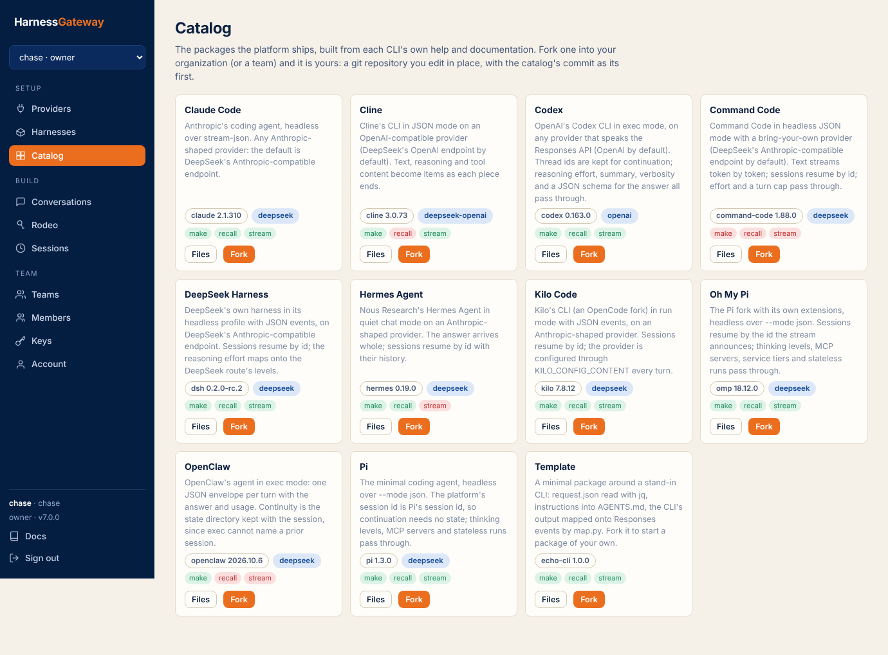
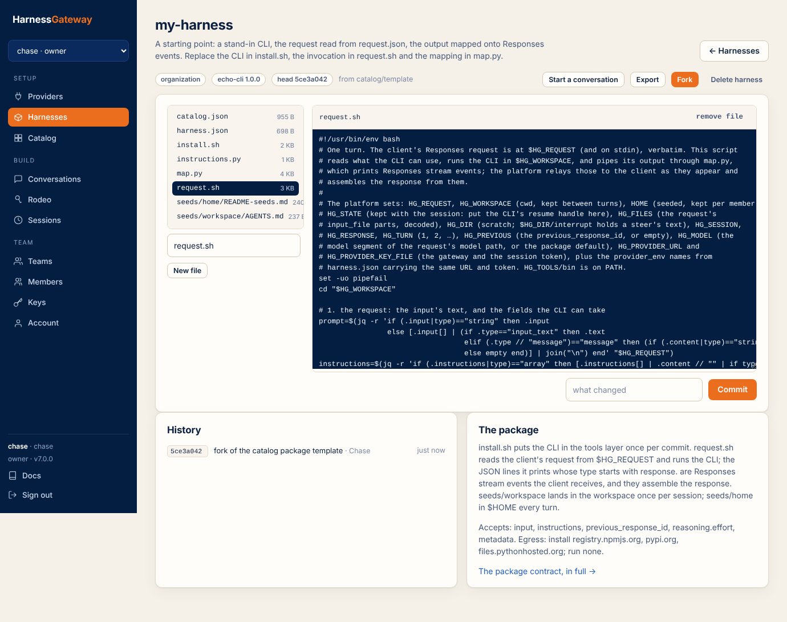
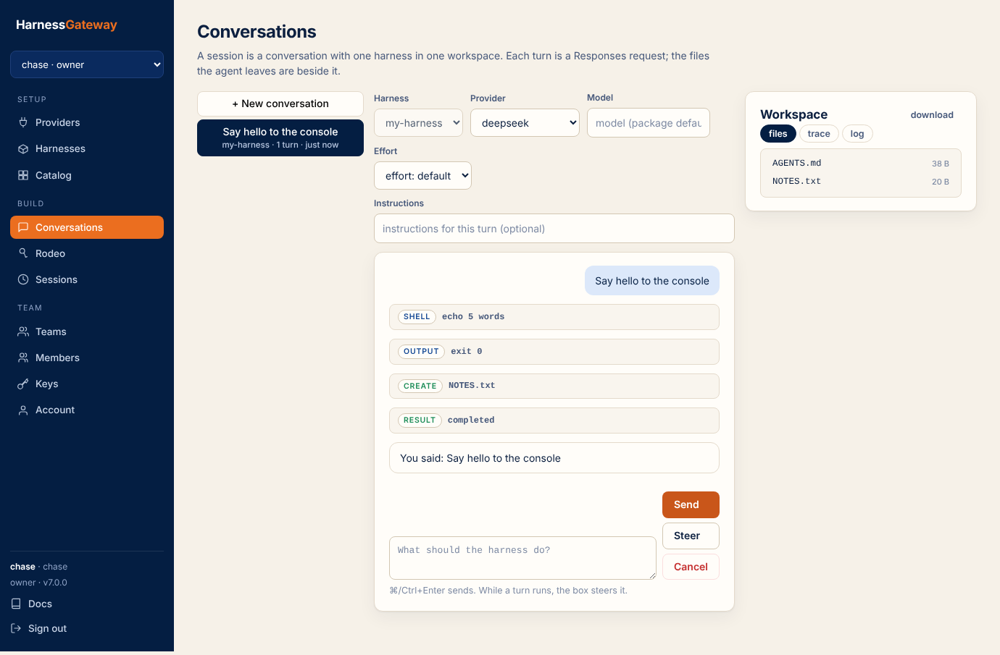
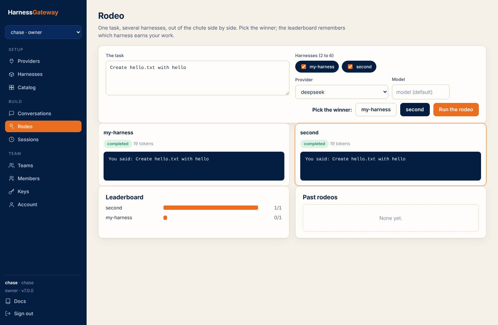
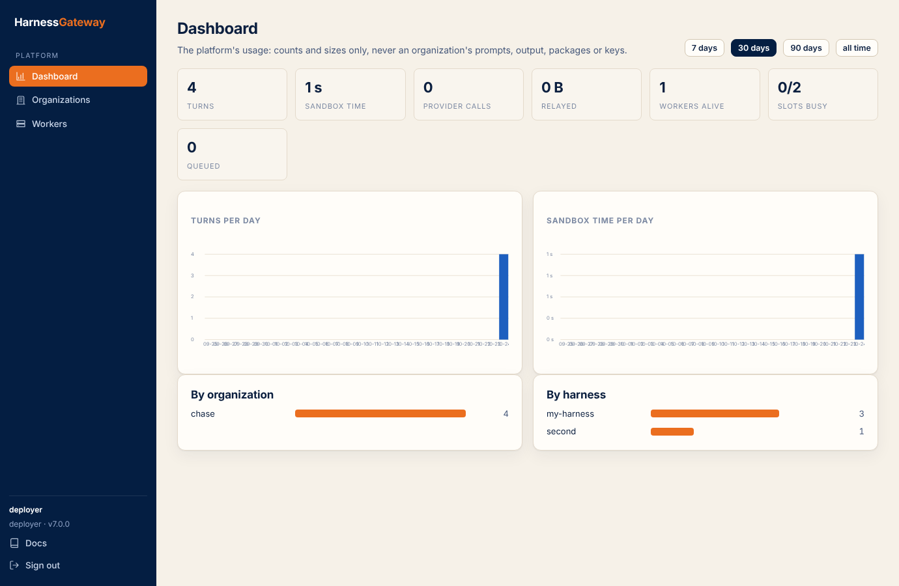

# The console

The console at `/app` is a plain web page over the same routes any client uses; nothing it does
is unavailable to the [API](api.md) or the [command line](cli.md). It is organized the way a new
organization proceeds.

| Section | Pages | What for |
|---|---|---|
| Setup | Start, Providers, Harnesses, Catalog | the checklist to a first turn and the API snippet; the endpoints and keys; the organization's packages with an editor; the shipped packages to fork |
| Build | Conversations, Rodeo, Sessions | talk to a harness with its workspace beside it (and the `api` tab to continue the same session from code); compare harnesses; every session with its trace |
| Team | Teams, Members, Keys, Usage, Organization, Account | who is in the organization and what they own; what it used, with what each meter means; the title, the plan, trace sharing and webhooks (owners) |

The deployer's key opens a different console: Dashboard (usage by meter, the dataset's size),
Organizations (create with a plan, suspend, limits, plan, trace sharing, billing id, per-organization
usage) and Nodes (the fleet).

<figure class="shot" markdown>

<figcaption>The catalog: each card shows the CLI's version, the default provider and the verification checks.</figcaption>
</figure>

<figure class="shot" markdown>

<figcaption>A harness: its files, an editor, the commit history, fork, export and delete.</figcaption>
</figure>

<figure class="shot" markdown>

<figcaption>A conversation: the items the harness produced (commands, patches, reasoning, messages) and the workspace pane with files, trace and log.</figcaption>
</figure>

<figure class="shot" markdown>

<figcaption>A rodeo: one task on several harnesses side by side, a winner picked, the leaderboard.</figcaption>
</figure>

<figure class="shot" markdown>

<figcaption>The deployer's dashboard: turns, sandbox time, provider calls and bytes relayed, by day, organization and harness.</figcaption>
</figure>
