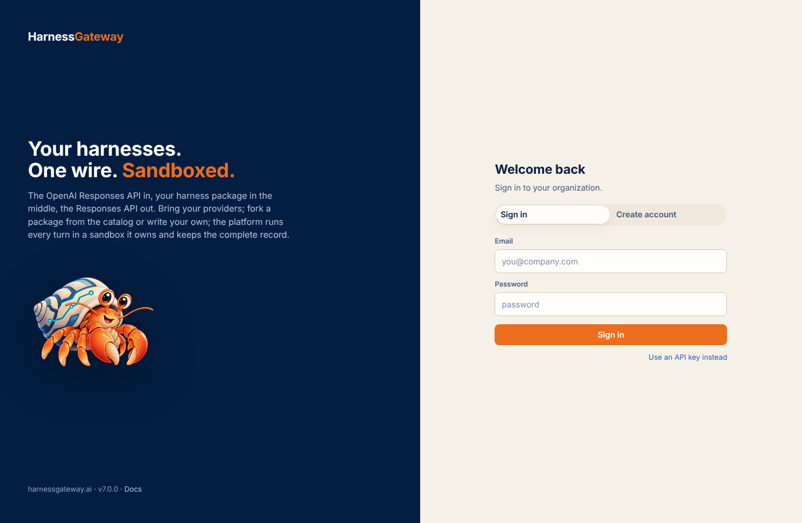

# First boot and sign-in

## What the first boot makes

An `api` that starts over an empty data directory makes what the platform lacks and prints it
once, to its log:

- the **master key**, written to `<data>/master.key` unless `HG_MASTER_KEY` or
  `HG_MASTER_KEY_FILE` is set; everything sealed (provider keys, worker credentials) is sealed
  with it. Back it up with the data directory.
- the **deployer key** (`hgd_…`), unless `HG_DEPLOYER_KEY` is set. It opens the deployer's routes
  and the deployer's console: organizations, their limits, the fleet, usage.
- with sign-up closed and no organization yet, the **first organization** (`HG_ORG`, default
  `main`) with its owner (`HG_OWNER`, default `owner`) and the owner's API key (`hg_…`).

```
first boot: shown once; `harnessgateway init` makes new ones
  deployer key: hgd_…
  org main created with owner owner
  owner's API key: hg_…
```

`harnessgateway init [--org NAME --owner NAME]` does the same by hand, at any time: a new deployer
key (replacing the old) and, with `--org`, that organization and its owner's key.

## Two ways in

**Accounts.** An account is an email and a password (or a GitHub or Google identity when the
deployer configured one), and it belongs to one or more organizations as a member. The console
signs in with an account. Sign-up creates an account and, when sign-up is open, an organization
of its own; when sign-up is closed, only an invited email can sign up, and it lands in the
organization that invited it.

**API keys.** A key (`hg_…`) names one member of one organization. Any OpenAI SDK uses it as
`api_key`; `hg login URL KEY` uses it for the command line; the console accepts it on the sign-in
page too ("Use an API key instead"). Owners mint keys for any member; members mint their own. A
member without an account, such as a service or a CI job, is a name and a key, added under
Members.

## Sign in

Open `/app`. With an account: email and password, or the identity provider's button. With a key:
"Use an API key instead" and paste it. The deployer's key (`hgd_…`) opens the deployer's console
instead of an organization's.

<figure class="shot" markdown>

<figcaption>The sign-in page; sign-up is a tab on it when the platform allows it.</figcaption>
</figure>

An account can belong to several organizations; the switcher at the top of the sidebar moves
between them, and "+ new organization" creates another (when sign-up is open).

## Verified email and password resets

With `HG_SMTP_URL` and `HG_MAIL_FROM` set, a sign-up has to verify its email before it is signed
in, and "Forgot your password?" sends a one-hour link. Without SMTP, sign-ups are signed in at
once and passwords are changed from the Account page.

## Next

[Providers](providers.md): the first thing an organization needs is a model endpoint and its key.
