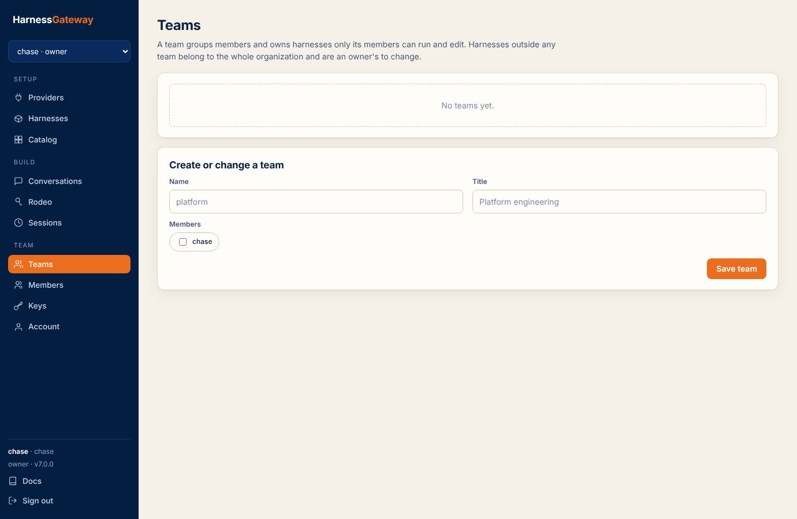

# Teams, members and keys

An organization has owners and members. Owners register providers, manage members and teams,
every harness and every session; members use the harnesses their teams own and the
organization's, and see their own sessions and their teams'. A team groups members and owns
harnesses only its members can run and edit; its sessions run in sandboxes of their own.

## Members

Members in the console, or `hg members`. Three ways to add one:

- **Invite by email** (`POST /v1/invites`): when that email signs up or signs in, it becomes a
  member with the role you chose. With sign-up closed, an invitation is the only way a new account
  can be created.
- **Add a name for a key** (`POST /v1/members`, `hg members add NAME --role member`): a member
  without an account, for a service or a script; mint it a key.
- **Sign-up**, when open: the account's own organization, with the account as owner.

`PATCH /v1/members/{name}` changes a role; `DELETE` removes the member and revokes their keys.

## Teams

Teams, or `hg teams put platform alice bob --title "Platform engineering"`. A team is a name, a
title and its members; `PUT /v1/teams/{name}` creates or replaces it. Harnesses are put in a team
when forked or imported (`--team`, the fork dialog) or moved later (`PATCH /v1/harnesses/{name}`
with `{"team": "platform"}`; `""` makes it organization-wide). A session made with a team's
harness is the team's: every member of the team sees it, can open it in Conversations and continue
it, and nobody else in the organization but an owner can. Its sandboxes run as a uid of the
team's own, not the organization's, so one team's runs are as apart from another team's on a
worker as two organizations' are.

<figure class="shot" markdown>

</figure>

## Keys

A key (`hg_…`) opens the organization as its member from any OpenAI SDK, `hg`, or the console. Mint
one per place it is used and revoke the one that leaks. Keys, or `hg keys new --label laptop`;
owners mint for any member (`--member NAME`). A key is shown once. `GET /v1/keys` lists them by
label, member and creation; `DELETE /v1/keys/{id}` revokes.

## Reach

Reach is organization, then team, then member: a member sees their own sessions and responses
and those of the teams they are in, an owner the organization's, nobody another organization's;
every miss is a 404. A key names one member; an
account switches between its organizations and acts as its member in each.
